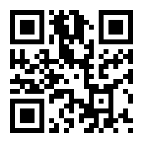

# OwnTV Fanart

🇬🇧 **[Read in English](README.md)**

**Una versión no oficial y modificada de [OwnTV](https://github.com/ahXN00/OwnTV) de [ahXN00](https://github.com/ahXN00)**,
mantenida por [Carlos (carlosglcn)](https://github.com/carlosglcn). Conserva todo lo que hace OwnTV y pone las
imágenes en primer plano: el fanart de la guía en Inicio, TV en directo y la guía, y algunos extras más.

> Los problemas de esta versión, por favor, repórtalos **aquí**, no al autor original.

https://github.com/user-attachments/assets/faacb82b-6903-47c0-ae53-6854024aa5b6

## ⬇️ Descarga

| Dispositivo | Última versión | Código de Downloader |
|---|---|---|
| Android TV (NVIDIA SHIELD, Google TV, Fire TV…) | [OwnTV-Fanart.apk](https://github.com/carlosglcn/OwnTV-Fanart/releases/latest/download/OwnTV-Fanart.apk) | **`6823827`** |
| Móvil / tablet Android | [OwnTV-Fanart-Mobile.apk](https://github.com/carlosglcn/OwnTV-Fanart-Mobile/releases/latest/download/OwnTV-Fanart-Mobile.apk) | **`6823148`** |

En una TV, abre **Downloader** (de AFTVnews), escribe el código e instala: siempre descarga la última versión.

Se instala **junto** a la app oficial (su propio paquete, `tv.own.owntv.glcn`) y te avisa dentro de la app cuando hay una versión nueva.

## ☕ Apoya el proyecto

OwnTV Fanart es gratis y se hace en ratos libres. Si te gusta cómo deja tu TV, puedes invitarme a un café: nunca se espera y siempre se agradece.

## 💬 Comunidad

Dudas, ideas o fallos — **únete a los grupos de Telegram:**

| OwnTV Fanart (esta versión) | OwnTV (app original) |
|---|---|
| ### 👉 [t.me/owntvfanart](https://t.me/owntvfanart) | ### 👉 [t.me/owntvplayer](https://t.me/owntvplayer) |
|  |  |

Los problemas de **esta versión** van al grupo de Fanart; el otro es para la app original.

## ✨ Qué cambia respecto a OwnTV

- **Fanart en todas partes** — imágenes de los programas de la guía (`<icon>` de XMLTV) en Inicio, TV en directo, la guía y el banner de zapping; imágenes anchas de TMDB cuando la guía solo trae un cartel.
- **Un Inicio nuevo** — cuatro diseños (*Clásico*, *Cine*, *Panel* y *Dock*), con destacados, Deportes ahora, Esta noche (con recordatorios) y películas y series recientes.
- **Tres diseños para Películas y Series** — los tres paneles clásicos, **Cinematográfico** (la portada del título enfocado a pantalla completa) o **Pasarela**: una fila de pósters donde el enfocado se abre ancho con su fondo y los demás se deslizan a un lado.
- **Una pantalla para lo que estás viendo** — pulsa Info en TV en directo: fanart del programa, logo, valoración, sinopsis, qué viene después y cuándo se vuelve a emitir esta semana.
- **Valoración, año y sinopsis de TMDB** junto a películas y series en directo.
- **Deportes** — fútbol, baloncesto (ACB, Euroliga), balonmano, tenis, Fórmula 1 y MotoGP con calendarios, marcadores en directo y clasificaciones.
- **Movimiento suave y tranquilo** — filas que se deslizan hasta el foco, tarjetas flotantes y un barrido de luz, o un estilo *Sutil*; un *Modo ligero* para aparatos antiguos.
- **Temas de temporada** (opcional) — Halloween, Navidad, Nochevieja, Carnaval y San Valentín, sonidos de menú y un acorde de apertura.
- **Sonido** — la mejor pista de audio en tu idioma, diálogos más claros y (en SHIELD) paso de Dolby/DTS también desde mpv.
- **TV y móvil juntos** — sincronización automática de favoritos e historial y *Ver en la TV* desde el móvil.
- **Emby** mediante M3U, Android Auto y un widget en el móvil, y un salvapantallas de fanart en la TV.

## 📄 Licencia y créditos

GPLv3, como OwnTV. Todo el mérito de la app en sí es de **ahXN00** y los colaboradores de OwnTV; el
logotipo **owntv** es de [@m3th0d93](https://github.com/m3th0d93). El icono de OwnTV Fanart es original de esta versión.
